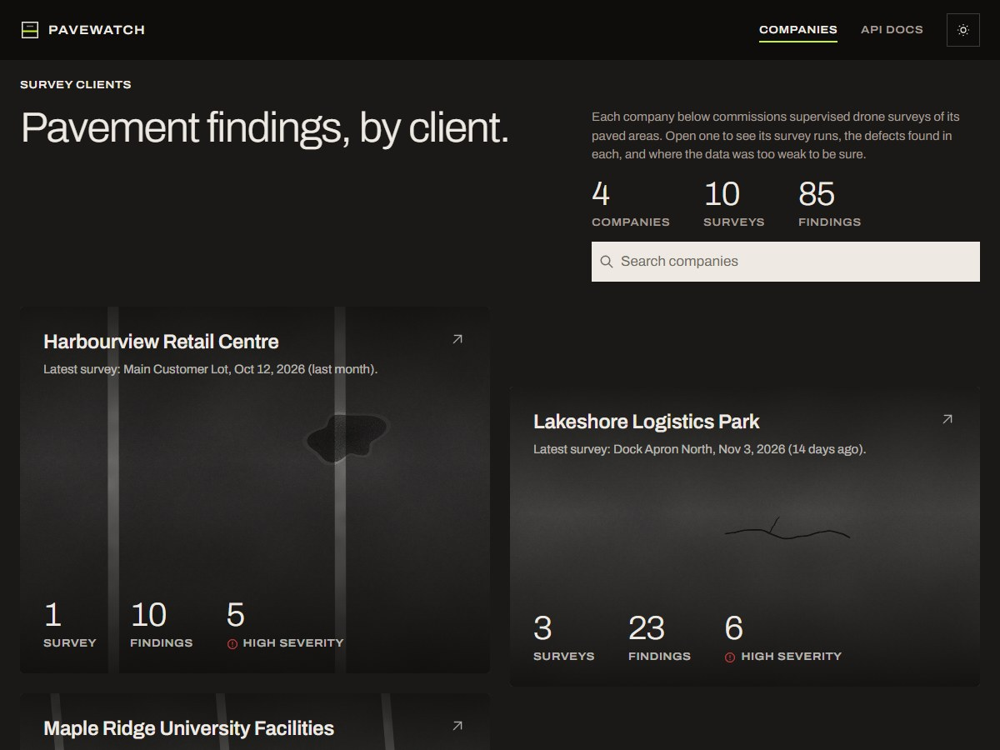
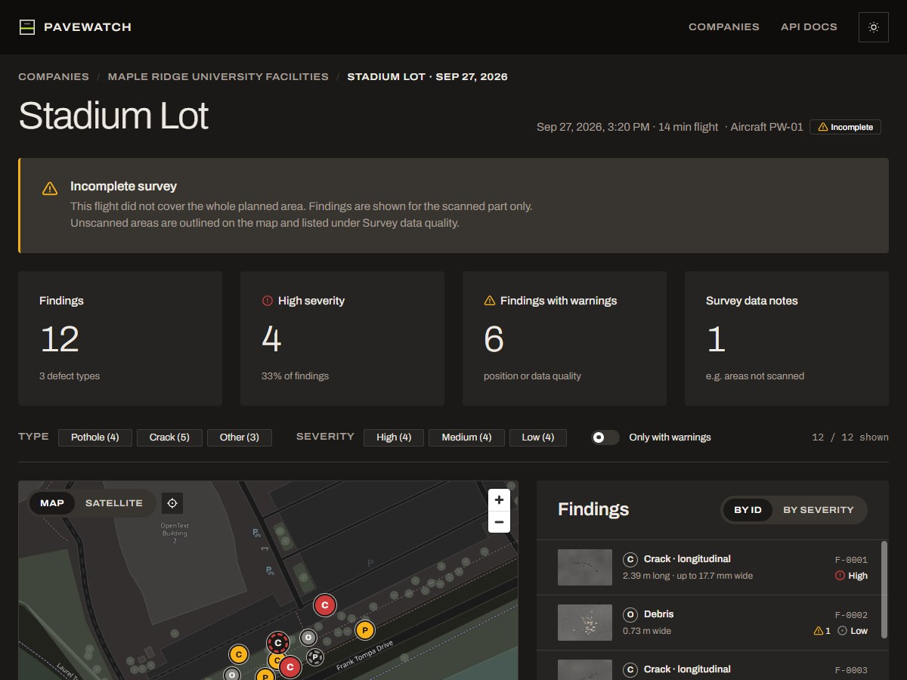
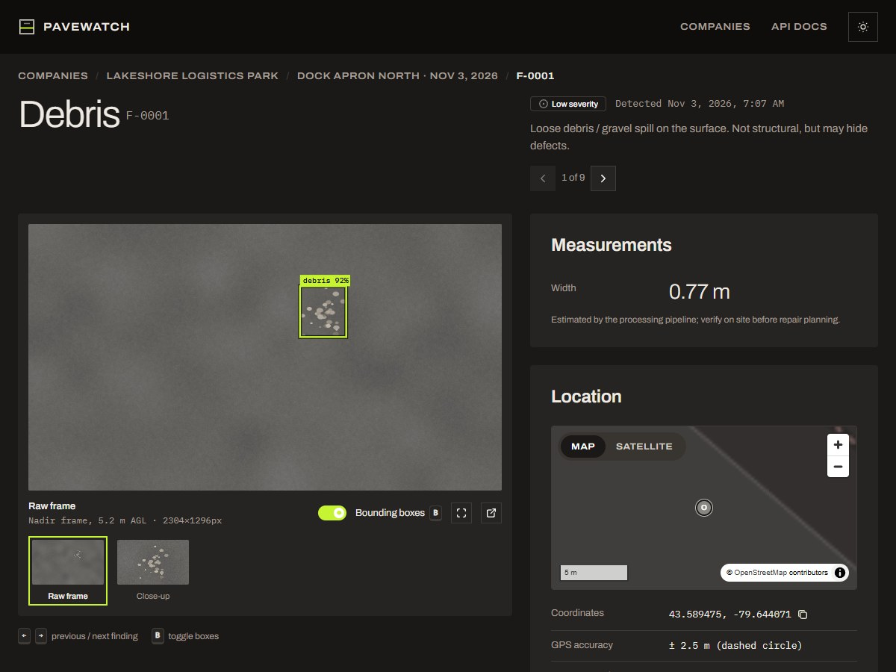

# PaveWatch Portal

Web portal for the **PaveWatch** capstone project (team Aerovengers). It covers subsystem 6, *Reporting, database and alerts*: it receives pavement-defect findings from the post-flight processing pipeline and shows them to the companies that bought the survey service.

Users pick a **company**, then a **survey run**, then browse its **findings** (potholes, cracks, depressions…) on a map and in a list. Each finding opens a detail page with its images, bounding boxes, measurements and location. Data-quality warnings are shown throughout, so users can tell "no defects found" apart from "not enough data to know".

| Companies                                    | Survey run                              | Finding                                         |
| -------------------------------------------- | --------------------------------------- | ----------------------------------------------- |
|  |  |  |

---

## Quick start (Windows)

Requirements: **Python 3.11+** and **Node.js 20+** (developed with Python 3.13 and Node 22).

```powershell
cd pavewatch-portal
powershell -ExecutionPolicy Bypass -File scripts\setup.ps1        # once: venv + Python packages + npm packages
powershell -ExecutionPolicy Bypass -File scripts\dev.ps1 -Seed    # start both servers and load demo data
```

Then open **http://localhost:5173**. API docs: **http://localhost:8000/docs**.

`-Seed` generates the synthetic demo data (4 fictional companies, 10 runs, ~85 findings) and uploads it through the real ingestion API. This takes a few minutes. Omit `-Seed` on later starts: the data is kept in `backend/data/`.

<details>
<summary>Manual steps (any OS)</summary>

```bash
# backend
cd backend
python -m venv .venv
.venv/Scripts/python -m pip install -r requirements.txt      # macOS/Linux: .venv/bin/python
.venv/Scripts/python -m uvicorn app.main:app --reload --port 8000

# frontend (second terminal)
cd frontend
npm install
npm run dev                                                   # http://localhost:5173

# demo data (third terminal, backend running)
backend/.venv/Scripts/python tools/synthetic/generate.py
```

</details>

### Single-server mode

`npm run build` in `frontend/` writes `frontend/dist/`. When that folder exists, the backend serves the portal itself at **http://localhost:8000**, which is handy for demos and for a container image later.

---

## Sending data to the portal

The processing pipeline uploads one survey run in three steps: **submit GeoJSON → upload evidence files → complete**. Everything the data sender needs is in:

- **[docs/ingestion-spec.md](docs/ingestion-spec.md)**: payload format, rules, API reference, errors, checklist
- **[docs/run-submission.schema.json](docs/run-submission.schema.json)**: JSON Schema (also served at `GET /api/v1/ingest/schema`)
- **[samples/sample_run/](samples/sample_run/)**: a complete valid example with images
- **[tools/uploader/pavewatch_upload.py](tools/uploader/pavewatch_upload.py)**: single-file uploader, standard library only

```bash
python tools/uploader/pavewatch_upload.py samples/sample_run/payload.geojson --url http://localhost:8000 --replace
```

---

## Architecture

```
 processing pipeline ──(GeoJSON + images, 3-step API)──▶  FastAPI backend  ──▶  SQLite (local) / Cloud SQL Postgres (later)
                                                          │   validation        └─▶ file storage: local disk / Cloud Storage (later)
                                                          │   thumbnails
 browser ◀── React + TypeScript (Vite) ◀── JSON API ──────┘
            Mantine UI · TanStack Query · MapLibre (OpenStreetMap / Esri imagery)
```

| Area          | Choice                                                                     | Why                                                                                                          |
| ------------- | -------------------------------------------------------------------------- | ------------------------------------------------------------------------------------------------------------ |
| Backend       | Python, FastAPI, Pydantic v2                                               | Same language as the pipeline; one schema definition drives validation, API docs and the JSON Schema         |
| Database      | SQLAlchemy 2 + Alembic, SQLite locally                                     | Only portable types, so Cloud SQL for PostgreSQL is a `PW_DATABASE_URL` change                             |
| Files         | `Storage` interface (`put / exists / delete_prefix / url`), local disk | A `GCSStorage` class with the same four methods moves images to Cloud Storage                              |
| Frontend      | React 19, TypeScript, Vite, Mantine 9                                      | Accessible components, light/dark mode                                                                       |
| Data fetching | TanStack Query                                                             | Caching and hover/neighbour prefetching make navigation instant                                              |
| Maps          | MapLibre GL                                                                | Provider code lives in one file (`frontend/src/components/map/basemap.ts`) for an easy swap to Google Maps |

### How ingestion works

1. `POST /api/v1/ingest/runs` validates the whole payload and reports every problem with its path. Rejections are logged.
2. `PUT …/files/{file}` stores each evidence file. Images are checked against their declared size and bounding boxes, and a 480 px thumbnail and a 1600 px preview are generated so the UI stays fast.
3. `POST …/complete` publishes everything in one database transaction. Until then nothing is visible. With `?replace=true`, a re-processed run swaps in atomically and the old files are deleted.

### PDF reports

The survey page has an **Export survey report (PDF)** button. Each open finding has a **PDF** button.

- **Survey report:** a summary page (run details, key figures, key points), an overview map with numbered markers, a breakdown by type and severity, survey data quality, a findings index (most severe first, IDs link to their pages), then one page per finding.
- **Finding report:** a single page with severity, facts, measurements, a location map, quality warnings, and the evidence images with bounding boxes drawn in.

The backend builds both (`GET /api/v1/orgs/{org}/runs/{run}/report.pdf` and `.../findings/{finding}/report.pdf`). Dates use the viewer's time zone, sent as `?tz=`. Map tiles are cached in `backend/data/tile-cache/`.

### Project layout

```
backend/
  app/
    api/            HTTP routes: ingest.py (data sender), portal.py (frontend)
    schemas/        ingest.py = the data contract; portal.py = API responses
    services/       ingest.py (3-step flow), portal.py (read queries), reports.py (PDF exports)
    reports/        PDF reports: pdf.py (layout, ReportLab), maps.py (static maps), images.py (boxes drawn in)
    db/             models.py (tables), session.py, migrate.py
    storage.py      file storage interface + local implementation
    config.py       settings (env vars PW_*)
  alembic/          database migrations
  tests/            pytest suite (ingestion, portal API, contract guards)
frontend/
  src/pages/        CompaniesPage, RunsPage, RunDetailPage, FindingDetailPage
  src/components/   map/ (MapLibre), ImageViewer, charts, badges, warnings
  src/api/          typed API client + query definitions
  src/lib/          labels, formatting, geo helpers
tools/
  uploader/         pavewatch_upload.py (for the data sender)
  synthetic/        demo data generator (render.py draws the images)
docs/               ingestion spec, JSON Schema, screenshots
samples/            example run for the data sender
scripts/            setup.ps1, dev.ps1
```

---

## Configuration

Environment variables (or `backend/.env`; see [backend/.env.example](backend/.env.example)):

| Variable               | Default                           | Purpose                                                                                             |
| ---------------------- | --------------------------------- | --------------------------------------------------------------------------------------------------- |
| `PW_DATABASE_URL`    | SQLite file in `backend/data/`  | Any SQLAlchemy URL, e.g. `postgresql+psycopg://…`                                                |
| `PW_STORAGE_DIR`     | `backend/data/files`            | Where evidence files are stored                                                                     |
| `PW_INGEST_API_KEY`  | *(empty: no key)*               | Require `X-API-Key` on ingestion endpoints                                                        |
| `PW_MAX_UPLOAD_MB`   | `50`                            | Max size per evidence file                                                                          |
| `PW_REPORT_BASEMAP`  | `true`                          | Draw OpenStreetMap streets under PDF report maps. `false`, or no network, gives a plain site plan |
| `PW_REPORT_TILE_URL` | OSM standard tiles                | Tile server for PDF maps (use a provider with a usage plan in production)                           |
| `PW_CORS_ORIGINS`    | `["http://localhost:5173", …]` | Allowed browser origins in dev                                                                      |

To reset all local data, stop the backend and delete `backend/data/`. The database is recreated on the next start.

## Development

```bash
cd backend && .venv/Scripts/python -m pytest -q          # 17 tests
cd frontend && npm run typecheck && npm run build
```

- **Changing the data contract** (`backend/app/schemas/ingest.py`): run `python -m app.export_schema` (from `backend/`) to refresh `docs/run-submission.schema.json`, and update `docs/ingestion-spec.md` and `frontend/src/api/types.ts` if responses change. A test fails if the published schema is stale.
- **Changing tables**: edit `backend/app/db/models.py`, then `alembic revision --autogenerate -m "…"` from `backend/`. Migrations run automatically at startup.
- **Colours**: severity uses reserved status colours (low = grey, medium = amber, high = red), checked for colour-blind separation and always paired with an icon and label. Tokens live in `frontend/src/styles/global.css`. Map overlay colours are mirrored in `basemap.ts`.

---

## Roadmap and known limitations

**Designed for, not built yet**

- **Login, multiple companies, roles.** Every tenant-owned table already has `org_id`, and every read goes through functions that take the organization explicitly (`backend/app/services/portal.py`). Portal URLs are nested under `/orgs/{org_id}/…`, so a membership check slots in without changing URLs. Planned roles: platform admin, organization admin, viewer. Identity could come from Google Identity Platform.
- **Cloud deployment.** Cloud Run (container), Cloud SQL for PostgreSQL (+ PostGIS for spatial queries), Cloud Storage for evidence with signed upload URLs. Step 2 of ingestion is already a plain `PUT` of raw bytes, so the sender's contract stays the same.
- **PDF export** and **survey-to-survey comparison** (the generator already re-surveys the same sites over time).

**Known limitations**

- **Base map tiles.** OpenStreetMap tiles and Esri imagery are fine for local use and demos, but their terms do not allow heavy production traffic. Switch providers (Google Maps, MapTiler, Stadia…) before a public deployment by editing `basemap.ts`.
- **Abandoned uploads.** If an ingestion is started but never completed, its files stay on disk. A cleanup job is planned.
- **No authentication.** Anyone who can reach the server can read everything. Ingestion can be protected with `PW_INGEST_API_KEY`.
- **Synthetic images** are drawn procedurally at half the Pi Camera 3 resolution (2304×1296). Real 4608×2592 frames work the same way.
